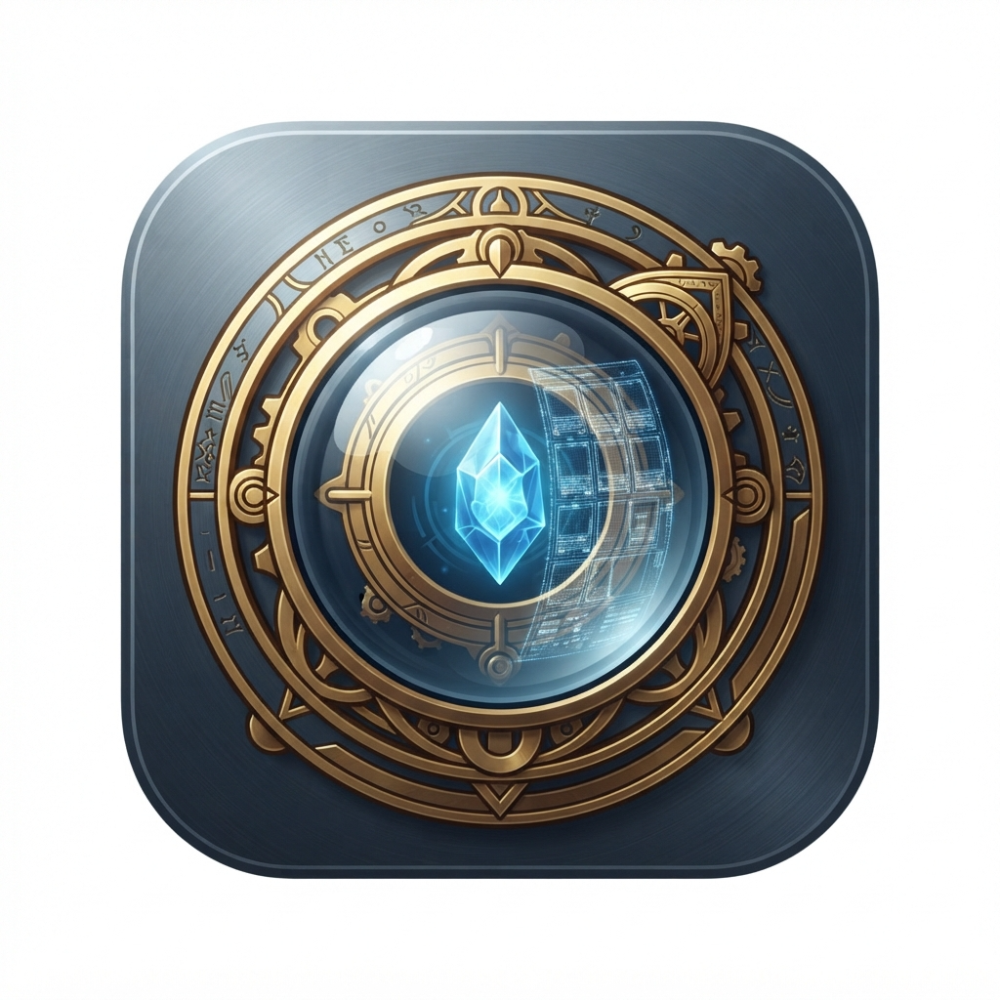

# Urza's Oculus

A native macOS companion for drafting Magic: The Gathering Arena on an
iPhone using macOS iPhone Mirroring.

Urza's Oculus observes the mirrored draft, identifies cards and packs,
tracks the draft, and provides deterministic pick recommendations.

## Project status

**Foundation scaffold.** The initial architecture and build pipeline are
being established. Screen capture and recognition are not implemented yet.

## Goals

- Capture the iPhone Mirroring window using macOS ScreenCaptureKit.
- Recognize packs and cards using local computer vision and OCR.
- Maintain an accurate record of the draft and drafted pool.
- Produce explainable, deterministic pick recommendations.
- Use versioned local reference data from sources such as Scryfall and
  17Lands.

## Design principles

- Native macOS application; minimum supported version macOS 14.
- Swift and SwiftUI.
- Local processing. No runtime AI inference or paid APIs.
- No automated interaction with Arena.
- No overlays or attempts to control the mirrored iPhone.
- Draft history is the source of truth.
- Keep capture, recognition, draft state, and scoring independently testable.

## Repository layout

    Sources/
      UrzasOculusApp/
      UrzasOculusCore/
        CaptureEngine/
        RecognitionEngine/
        DraftEngine/
        ScoringEngine/
        DataEngine/
        CollectionEngine/
    Tests/
      UrzasOculusCoreTests/
    docs/
    scripts/
    .github/workflows/

## Development

The project uses Swift Package Manager.

On a compatible Mac:

    swift test
    swift run

To create an application bundle:

    ./scripts/package-app.sh

The script produces dist/UrzasOculus-macos.zip.

GitHub Actions runs the native macOS build and tests. GitHub Codespaces
can be used for browser-based editing and Git operations, but its Linux
environment cannot run the native macOS application.

## Project documentation

- [Project steering](docs/PROJECT_STEERING.md)
- [Architecture](docs/ARCHITECTURE.md)
- [Technical spike](docs/TECHNICAL_SPIKE.md)
- [Architecture decisions](docs/DECISIONS.md)

## License

License to be determined before public distribution.
