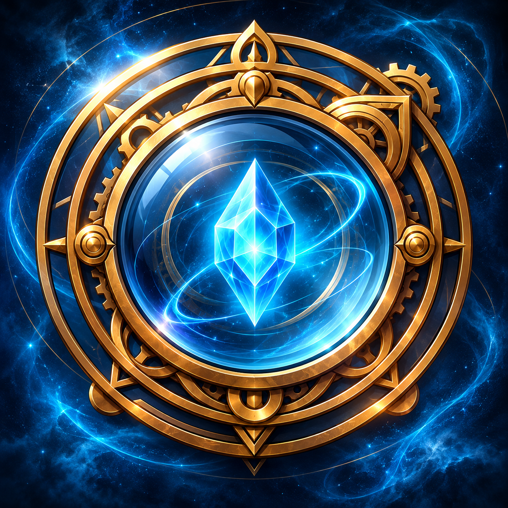

# Urza's Oculus

**An arcane instrument for seeing the shape of a draft.**

Urza's Oculus is an independent native macOS companion project for Magic: The Gathering Arena drafting. The long-term goal is to combine reliable draft observation, explicit draft history, versioned reference data, and explainable recommendations.

The project is under active development. The current app is a **Phase 0 ScreenCaptureKit feasibility prototype**, not a complete draft tracker or recommendation companion.



## Current status

The prototype can enumerate visible, shareable macOS windows; suggest likely iPhone Mirroring windows using an advisory heuristic; let the user select a target; capture a still image; and capture a bounded three-second sequence (up to four frames per second, maximum twenty frames).

The immediate next step is real-world validation on the target Mac using an Arena draft recording, including scrolling and pack changes.

**Not implemented or integrated:** OCR, card recognition, automatic draft observation, a user-facing draft tracker, and live pick recommendations. Some underlying domain, data, and scoring foundations exist independently; they are not connected into a complete user workflow.

See [the roadmap](docs/ROADMAP.md).

## What exists today

| Area | Status |
|---|---|
| macOS app and ScreenCaptureKit prototype | Implemented; real-world validation pending |
| RecognitionEngine | Placeholder; OCR/card recognition not implemented |
| DraftEngine | Append-only event model, validation, and replay tests; no persistence or capture integration |
| Scryfall reference data | SQLite schema and importer implemented |
| 17Lands public archive acquisition and CSV parsing | Implemented |
| 17Lands game/draft metric aggregation | Implemented with fixture tests and HOB archive validation |
| 17Lands game eligibility semantics | Open correctness question; exact parity is not claimed |
| Recommendation readiness | Implemented; requires compatible draft and game snapshots |
| Recommendation evaluator | Deterministic standalone GIH WR baseline in shared Swift core |
| Synergy, archetype, curve, deck-needs scoring | Not implemented |
| Website | Hugo site deployed via Cloudflare Pages |
| Capture-to-recommendation workflow | Not integrated |

The metric audit and its caveats are documented in [17Lands metric semantics](docs/17lands-metric-semantics.md). Implementation parity between two local implementations does not prove exact parity with 17Lands' own card-rating calculations.

## Principles

- **Local first:** captured frames and draft observations stay local. No cloud inference or runtime AI dependency.
- **Player controlled:** Oculus does not click, type, select cards, or automate Arena.
- **Deterministic and explainable:** recommendation logic lives in one testable Swift core.
- **Draft history is authoritative:** the drafted pool is reconstructed from explicit events and corrections.
- **Honest about evidence:** provenance, sample sizes, missing data, readiness, and limitations remain visible.
- **Incremental:** validate risky assumptions before building dependent features.

## Repository layout

```text
Sources/                 Swift app and core engines
Tests/                   Swift unit tests
scripts/                 Archive validation and packaging
docs/                    Architecture, decisions, data and roadmap
website/                 Hugo website
.github/workflows/       CI and explicit archive audits
```

## Development

Requirements: macOS 14+ for the native app, a compatible Swift toolchain, Python 3 for scripts, and Hugo Extended 0.147.9 for the website.

On a compatible Mac, from the repository root:

```sh
swift test
swift run
./scripts/package-app.sh
```

The package script creates dist/UrzasOculus-macos.zip.

Python tests:

```sh
python3 -m unittest discover -s scripts -p 'test_*.py'
```

Website:

```sh
cd website
hugo server
```

See [CONTRIBUTING.md](CONTRIBUTING.md) and [website setup](website/README.md).

## Data sources and attribution

- [Scryfall](https://scryfall.com) provides card metadata and printing identifiers. Respect its data and image policies.
- [17Lands](https://www.17lands.com) provides public Limited datasets and metric definitions. Preserve provenance and attribution; public datasets are generally CC BY 4.0 unless otherwise noted.
- Magic: The Gathering and MTG Arena are trademarks of Wizards of the Coast. Urza's Oculus is independent and is not affiliated with or endorsed by Wizards of the Coast.

Third-party datasets, card images, and trademarks are not relicensed by this repository's software license.

## Documentation

- [Roadmap and implementation status](docs/ROADMAP.md)
- [Project steering](docs/PROJECT_STEERING.md)
- [Architecture](docs/ARCHITECTURE.md)
- [Architecture decisions](docs/DECISIONS.md)
- [Technical capture spike](docs/TECHNICAL_SPIKE.md)
- [Data schema](docs/DATA_SCHEMA.md)
- [17Lands metric semantics audit](docs/17lands-metric-semantics.md)
- [Brand and visual style guide](docs/BRANDING.md)

## License

Source code is licensed under GNU GPL v3.0 only. See [LICENSE](LICENSE).
